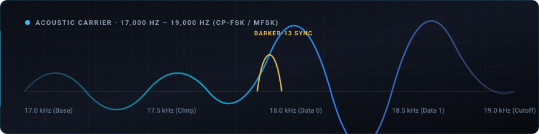

<div align="center">
  
</div>

<p align="center">
  
  
  
  
  
</p>

---

## Overview

**UltraLink** is an offline-capable, device-to-device acoustic data communication Progressive Web App (PWA). Operating over inaudible near-ultrasonic acoustic frequencies (**17.0 kHz – 19.0 kHz**) via standard device speakers and microphones, UltraLink enables local data, text, and file exchange without Wi-Fi, Bluetooth, cellular data, or local pairing.

The system features a custom digital signal processing (DSP) pipeline implemented entirely in TypeScript and the Web Audio API, using continuous-phase frequency shift keying (CP-FSK / MFSK), Barker-13 packet framing, and dedicated real-time audio thread demodulation via an `AudioWorklet`.

---

## Architectural Topology

```
+-----------------------------------------------------------------------------------+
|                              ULTRALINK PWA INTERFACE                              |
|   Next.js 14 · Cybernetic Dark UI · Responsive Mobile / Desktop Layout           |
|   Three.js PredictiveArcCanvas Background · Zero-Jitter Design Tokens            |
+-----------------------------------------+-----------------------------------------+
                                          |
        +---------------------------------+---------------------------------+
        v                                                                   v
+---------------------------------------+  +----------------------------------------+
|       AUDIO DSP MODULATOR ENGINE      |  |     AUDIOWORKLET REAL-TIME RECEIVER    |
| - 17.0 - 19.0 kHz Tone Synthesis      |  | - Dedicated Audio-Thread Processing    |
| - Tukey Cosine Windowing              |  | - Goertzel Filter Bank Demodulator     |
| - Dual Sample Rate Support (44.1/48k) |  | - Dynamic Noise Floor & SNR Tracking   |
| - Pure TS 16-bit PCM WAV Codec        |  | - Automatic Frequency Control (AFC)    |
+-------------------+-------------------+  +-------------------+--------------------+
                    |                                          |
                    +--------------------+---------------------+
                                         v
+-----------------------------------------------------------------------------------+
|                        BINARY PACKET FRAMING & PROTOCOL                           |
|   Preamble Chirp -> Barker-13 Sync -> 8-Byte CRC8 Header -> Payload Chunking      |
|   -> CRC32 Integrity Trailer -> Postamble Pulse                                   |
+-----------------------------------------------------------------------------------+
```

---

## Modulation & Protocol Specifications

### 1. Carrier Band & Profiles
UltraLink modulates data across 4 configurable transmission profiles designed to balance throughput against acoustic multipath interference:

| Profile | Baud Rate | Tone Spacing | Target Environment |
| :--- | :---: | :---: | :--- |
| **Reliable** | 8 baud | 125 Hz | High-reverberation rooms, noisy environments, distance |
| **Balanced** | 16 baud | 62.5 Hz | Standard office, quiet room, medium distance |
| **Fast** | 32 baud | 31.25 Hz | Close-range, clean line-of-sight between devices |
| **Experimental** | 64 baud | 15.625 Hz | Laboratory testing and high-fidelity transducer trials |

### 2. Binary Packet Structure
All transmissions follow strict packet framing with dual-stage cyclic redundancy verification:
- **Preamble**: Up-chirp sweep initiating receiver Automatic Gain Control (AGC).
- **Synchronization**: 13-bit Barker sequence (`+1, +1, +1, +1, +1, -1, -1, +1, +1, -1, +1, -1, +1`) providing sharp cross-correlation peaks for microsecond-precise bit alignment.
- **Header**: 8-byte structured block containing protocol version, transmission profile ID, total chunks, chunk index, and an 8-bit CRC.
- **Payload**: Arbitrary UTF-8 or raw binary chunk (up to 64 bytes per packet).
- **Trailer**: IEEE 802.3 CRC32 checksum verifying complete packet integrity prior to reassembly.
- **Postamble**: Down-chirp tone signaling transmission termination.

### 3. Doppler & Drift Hardening
Acoustic channels suffer from hardware clock drift and subtle Doppler shifts from moving devices. UltraLink employs:
- **Parabolic Interpolation**: Sub-bin peak frequency estimation resolving frequency offsets below FFT bin resolution.
- **Dynamic Energy Thresholding**: Compares Goertzel bin magnitude against sliding-window ambient noise floors to maintain zero false-positive decodes.

---

## Getting Started

### Prerequisites
- Node.js 18.18+ or 20.x
- Modern web browser with Web Audio API support (Chrome, Firefox, Safari, Edge)

### Installation
```bash
# Clone the repository
git clone https://github.com/psychspy7/UltraLink.git
cd UltraLink

# Install dependencies
npm install

# Start development server
npm run dev
```
Open [http://localhost:3000](http://localhost:3000) in your browser.

---

## Verification & Test Suite

The acoustic DSP engine includes automated unit tests verifying tone generation, Barker correlation, packet fragmentation, and noise resilience:

```bash
# Run all unit tests with Vitest
npm test

# Run tests in watch mode during development
npm run test:watch
```

---

## Privacy & Security

- **100% Client-Side Processing**: Audio synthesis and demodulation occur entirely in the user's browser memory via Web Audio and AudioWorklet. No microphone audio is ever transmitted to a server.
- **Air-Gapped Isolation**: Core transmission and reception operate completely offline.
- **Strict Content Security**: No external trackers, advertising beacons, or third-party analytical scripts.

---

## License

Proprietary · Engineered by Virat Anand for Kitty Corp.
